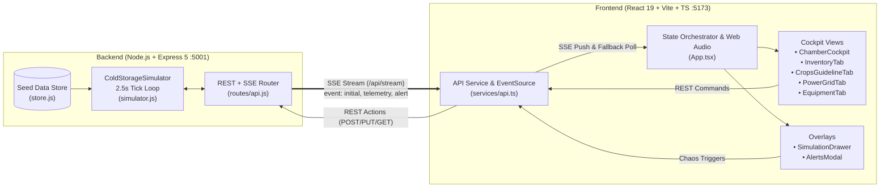

# ❄️ HimKosh (हिमकोश) — Smart Cold Storage Telemetry & Management System


**HimKosh** (हिमकोश — *Him* = Cold/Frost, *Kosh* = Vault/Depository) is a full-stack real-time industrial telemetry, farmer lot inventory, microgrid energy, and predictive maintenance platform built for multi-commodity cold-chain logistics hubs (modeled after **HimKosh Agro-Logistics Hub #4** in the *Kashmir-Himachal Agri Corridor*, total capacity **780 MT** across 5 specialized climate vaults).

It pairs a physics-inspired Node.js simulation engine that streams live telemetry over **Server-Sent Events (SSE)** with a high-contrast industrial SCADA/cockpit interface built in React 19 and Tailwind CSS v4.

---

## Table of Contents

1. [System Architecture](#system-architecture)
2. [Core Modules & UI Views](#core-modules--ui-views)
3. [Simulation Engine & Physics Model](#simulation-engine--physics-model)
4. [Facility Configuration & Seed Data](#facility-configuration--seed-data)
5. [Tech Stack](#tech-stack)
6. [Project Structure](#project-structure)
7. [Getting Started](#getting-started)
8. [API & SSE Reference](#api--sse-reference)
9. [Chaos Testing & Fault Simulation Guide](#chaos-testing--fault-simulation-guide)
10. [License](#license)

---

## <a id="system-architecture"></a>🏗 System Architecture



---

## <a id="core-modules--ui-views"></a>🖥 Core Modules & UI Views

### 1. Flagship Chamber Cockpit (`ChamberCockpit.tsx`)
- **Split-Screen Industrial Console**: Real-time monitoring of all 5 climate chambers (`CH-1` through `CH-5`).
- **Live Sensor Readouts**: Temperature (°C), Relative Humidity (%), Ethylene concentration (ppm), ambient temperature differential, compressor status, and 20-point historical temperature sparklines.
- **Rack-Level Bay Visualization**: Inspect individual physical racks (`R1-A`, `R1-B`, etc.) showing occupancy, batch lot ID, farmer owner, and tonnage.
- **Direct Setpoint & Hardware Controls**: Calibrate target temperature and humidity, unseal/seal chamber doors, initiate electric coil defrost cycles, inject thermal spikes, or restore safe agronomic defaults.

### 2. Farmer Produce Inventory & Billing Ledger (`InventoryTab.tsx`)
- **End-to-End Lot Tracking**: Manage stored agricultural batches with lot numbers (`LOT-YYYY-NNN`), farmer contact & district origin, quality grade (`Grade A+`, `Premium`, `Export Quality`, `HACCP Certified`), crate count, and metric tonnage (MT).
- **Dynamic Capacity Sync**: Adding or dispatching lots automatically recalculates chamber utilization (`usedMT` vs. `capacityMT`) and facility-wide occupancy percentages.
- **Automated Dispatch & Billing**: One-click lot dispatch calculates total storage days (`dispatchedAt - intakeDate`) and final invoice amount (`days × quantityMT × dailyRatePerMT`).

### 3. Crop Agronomic Preservation Matrix (`CropsGuidelineTab.tsx`)
- Built-in reference database of post-harvest preservation parameters across 7 crop categories.
- Displays ideal vs. critical safe temperature bounds, relative humidity windows, maximum ethylene tolerance (ppm), maximum shelf life (days), daily storage tariff per MT, and recommended chamber mapping.

### 4. Solar-Hybrid Microgrid & Thermal Bank (`PowerGridTab.tsx`)
- **Rooftop PV & Grid Telemetry**: Tracks real-time solar generation (kW), irradiance (%), facility chill load (kW), net-zero grid export/import, daily USD savings, and CO₂ offset (kg).
- **LiFePO4 Battery Energy Storage System (BESS)**: Monitors State of Charge (SoC %), kWh reserve, charge/discharge kW flow, and estimated backup runtime hours.
- **Phase-Change Thermal Ice Bank**: Tracks chilled glycol/ice storage charge (%) and ton-hour discharge rates used to offload compressors during peak tariffs or grid outages.
- **Interactive Mode Switching**: Switch between `SOLAR_HYBRID`, `BATTERY_BACKUP`, `THERMAL_DISCHARGE`, `GRID_ONLY`, and `GENSET_EMERGENCY`.

### 5. Equipment Health & Predictive Maintenance (`EquipmentTab.tsx`)
- Monitors 7 critical industrial assets including **Bitzer Screw Compressors**, **Carlyle Semi-Hermetic Racks**, **Evaporator Fan Arrays**, **Induced-Draft Condenser Towers**, **Cummins 250 kVA Diesel Gensets**, and **SolarEdge Smart Inverters**.
- Tracks Coefficient of Performance (COP), suction/discharge pressures (PSI), motor vibration (mm/s), oil levels, run-hours since last service, and mineral scale warnings.
- **One-Click Technician Service**: Resets run-hour counters, clears scale warnings, updates maintenance dates, and logs an audit alert.

### 6. Real-Time Alerting & Web Audio Synthesizer (`AlertsModal.tsx` & `SimulationDrawer.tsx`)
- **Zero-Dependency Audio Alarms**: Uses the browser's native **Web Audio API** (`AudioContext` sine wave oscillator ramping 880 Hz → 440 Hz) to sound an audible chime whenever a `CRITICAL` alert occurs (can be muted in the sidebar).
- **Incident Lifecycle**: Acknowledge (`acknowledged: true`) or resolve (`resolved: true`) alerts across `TEMPERATURE`, `SECURITY`, `POWER`, and `EQUIPMENT` categories.
- **Simulation Chaos Drawer**: Dedicated slide-over drawer to trigger fault scenarios (door breaches, thermal spikes, defrost cycles, microgrid outages) from anywhere in the app.

---

## <a id="simulation-engine--physics-model"></a>⚙️ Simulation Engine & Physics Model

The backend [`ColdStorageSimulator`](backend/src/simulator.js) runs an autonomous tick loop every **2,500 ms** (`2.5s`) and broadcasts updates to all connected SSE clients:

1. **Normal Closed-Loop Regulation**:
   - Temperature pulls toward `targetTemp` with proportional convergence plus stochastic sensor micro-drift:
     $$\Delta T = (T_{\text{target}} - T_{\text{current}}) \times 0.15 + \mathcal{U}(-0.06, +0.06)$$
   - Relative humidity converges toward `targetHumidity` within [40%, 99%] bounds, while ethylene ppm exhibits minor biological respiration drift.
2. **Door Open Thermal Infiltration (`doorOpen = true`)**:
   - Warm external air (29.5°C ambient) infiltrates the chamber:
     $$T_{\text{next}} = T_{\text{current}} + (T_{\text{ambient}} - T_{\text{current}}) \times 0.05$$
   - Humidity drops by 0.8% per tick (down to 50%), and a `WARNING` security alert is immediately emitted.
3. **Electric Coil Defrost (`defrostActive = true`)**:
   - Electric coil heaters gently warm the chamber by +0.2°C per tick up to $T_{\text{target}} + 3.0^\circ\text{C}$.
4. **Automated Agronomic Threshold Evaluation**:
   - Compares `currentTemp` against the assigned crop's `maxSafeTemp`, `minSafeTemp`, `idealTempMax`, and `idealTempMin`:
     - `currentTemp > maxSafeTemp` → Status becomes `CRITICAL_HIGH` and auto-dispatches a `CRITICAL` temperature alert.
     - `currentTemp < minSafeTemp` → Status becomes `CRITICAL_LOW` (frost/chill injury risk) and auto-dispatches a `CRITICAL` alert.
     - Outside ideal window by > 0.5°C → Status becomes `WARNING`.
     - Otherwise → `OPTIMAL`.
5. **Microgrid Power Balancing**:
   - Dynamically computes net solar surplus/deficit (`solarGenerationKw - facilityLoadKw`), toggles between grid export and import, and adjusts battery SoC (%) or thermal ice bank charge (%) based on the active power mode.

---

## <a id="facility-configuration--seed-data"></a>🏢 Facility Configuration & Seed Data

### Cold Chambers (`780 MT` Total Capacity)

| ID | Chamber Name | Assigned Commodity | Target Temp | Target RH | Capacity | Racks |
| :--- | :--- | :--- | :---: | :---: | :---: | :---: |
| **CH-1** | Chamber 1 - Pome & Root Vault | Apples (Fuji / Royal Gala) | `1.0°C` | `93%` | 160 MT | `R1-A` – `R1-D` |
| **CH-2** | Chamber 2 - Tubers Climate Cell | Potatoes (Table & Seed) | `8.0°C` | `90%` | 320 MT | `R2-A` – `R2-D` |
| **CH-3** | Chamber 3 - High-Care Berry Cell | Strawberries & Berries | `0.5°C` | `94%` | 80 MT | `R3-A` – `R3-C` |
| **CH-4** | Chamber 4 - Controlled Tropical Vault | Bananas & Tropical Fruit | `13.0°C` | `88%` | 120 MT | `R4-A` – `R4-C` |
| **CH-5** | Chamber 5 - Sub-Zero Deep Freeze | Frozen Poultry & Meat | `-20.0°C` | `90%` | 100 MT | `R5-A` – `R5-C` |

### Crop Preservation Profiles

| Crop ID | Commodity Name | Ideal Temp | Safe Temp Bounds | Ideal Humidity | Max Ethylene | Max Shelf Life | Tariff / MT / Day |
| :--- | :--- | :---: | :---: | :---: | :---: | :---: | :---: |
| `apples` | Apples (Fuji / Royal Gala) | `0.0°C` to `2.5°C` | `-1.5°C` to `4.0°C` | `90% – 95%` | `1.0 ppm` | 180 days | `$210` |
| `potatoes` | Potatoes (Table & Seed) | `7.0°C` to `10.0°C` | `4.5°C` to `13.0°C` | `85% – 92%` | `2.0 ppm` | 240 days | `$150` |
| `strawberries` | Strawberries & Berries | `-0.5°C` to `1.5°C` | `-1.5°C` to `3.5°C` | `90% – 95%` | `0.5 ppm` | 21 days | `$380` |
| `bananas` | Bananas & Tropical Fruit | `12.0°C` to `14.5°C` | `10.5°C` to `16.5°C` | `85% – 90%` | `0.2 ppm` | 45 days | `$250` |
| `frozen_poultry` | Frozen Poultry & Meat | `-22.0°C` to `-18.0°C` | `-26.0°C` to `-14.0°C` | `85% – 92%` | `0.0 ppm` | 365 days | `$420` |
| `carrots` | Carrots (Crisp Bulk) | `0.0°C` to `1.5°C` | `-1.0°C` to `3.0°C` | `95% – 98%` | `1.0 ppm` | 150 days | `$170` |
| `onions` | Dry Onions (Red & White) | `0.0°C` to `2.0°C` | `-1.0°C` to `5.0°C` | `65% – 72%` | `1.5 ppm` | 210 days | `$160` |

---

## <a id="tech-stack"></a>🛠 Tech Stack

- **Frontend (`/frontend`)**
  - **Framework**: React `^19.1.1` + React DOM `^19.1.1`
  - **Language**: TypeScript `~5.8.3`
  - **Build Tool**: Vite `^7.1.7` (`@vitejs/plugin-react`)
  - **Styling**: Tailwind CSS `^4.3.3` (`@tailwindcss/vite`)
  - **Icons**: `lucide-react` `^1.62.0`
  - **Audio**: Native Browser Web Audio API (`AudioContext`)
  - **Realtime Client**: Native Browser `EventSource` (Server-Sent Events) + `fetch` API
- **Backend (`/backend`)**
  - **Runtime**: Node.js (ES Modules `"type": "module"`)
  - **Web Framework**: Express `^5.3.0`
  - **Middleware**: `cors` `^2.8.6`, `express.json()`
  - **Realtime Transport**: Native HTTP `text/event-stream` (SSE)

---

## <a id="project-structure"></a>📂 Project Structure

```text
Cold_Storage/
├── README.md
├── .gitignore
├── backend/
│   ├── package.json                  # Backend scripts & dependencies (Express 5, CORS)
│   └── src/
│       ├── server.js                 # Express app setup, CORS config & health check (:5001)
│       ├── simulator.js              # ColdStorageSimulator class (2.5s tick loop & SSE broadcaster)
│       ├── data/
│       │   └── store.js              # Initial seed data (crops, chambers, 12 lots, 7 equipment units, power, alerts)
│       └── routes/
│           └── api.js                # 18 REST endpoints + GET /api/stream SSE endpoint
└── frontend/
    ├── index.html                    # HTML shell
    ├── package.json                  # Frontend scripts & dependencies (React 19, Vite 7, Tailwind 4)
    ├── tsconfig.json                 # TypeScript root configuration
    ├── vite.config.ts                # Vite bundler configuration
    └── src/
        ├── main.tsx                  # React DOM root mount
        ├── App.tsx                   # Application shell, SSE lifecycle, Web Audio chime & toast manager
        ├── index.css                 # Tailwind CSS imports & custom grid/industrial utilities
        ├── types/
        │   └── index.ts              # Strict TypeScript interfaces for all telemetry & domain entities
        ├── services/
        │   └── api.ts                # Typed REST fetch wrappers & subscribeTelemetryStream() SSE handler
        └── components/
            ├── Sidebar.tsx           # Left navigation rail, alert badges, audio mute & sim drawer trigger
            ├── TopHUD.tsx            # Top telemetry bar (facility health, occupancy, solar/battery KPIs)
            ├── ChamberCockpit.tsx    # Split-screen chamber selector, live gauges, sparklines & rack bays
            ├── ChamberCard.tsx       # Individual chamber summary card component
            ├── OverviewStats.tsx     # High-level KPI metric cards
            ├── InventoryTab.tsx      # Farmer lot table, search/filter, intake modal & dispatch billing
            ├── CropsGuidelineTab.tsx # Agronomic preservation matrix & chamber cross-navigation
            ├── PowerGridTab.tsx      # Solar PV, LiFePO4 battery, thermal ice bank & mode switcher
            ├── EquipmentTab.tsx      # Compressor/condenser/genset telemetry & maintenance logging
            ├── AlertsModal.tsx       # Slide-over incident feed with severity filters & ack/resolve actions
            ├── SimulationDrawer.tsx  # Chaos engineering drawer for injecting thermal/power/door faults
            └── Navbar.tsx            # Auxiliary navigation bar component
```

---

## <a id="getting-started"></a>🚀 Getting Started

### Prerequisites
- **Node.js** `v18.0.0` or higher (recommended `v20+` for native `node --watch` support)
- **npm** `v9+`

### 1. Start the Backend Telemetry Server

Open a terminal in the project root:

```bash
cd backend
npm install
npm run dev
```

- Runs `node --watch src/server.js` on **`http://localhost:5001`** (configurable via the `PORT` environment variable).
- Verify health check at [`http://localhost:5001/`](http://localhost:5001/):
  ```json
  {
    "status": "online",
    "name": "HimKosh Smart Cold Storage Telemetry API",
    "version": "2.4.0",
    "time": "2026-10-29T18:07:06.000Z"
  }
  ```

### 2. Start the Frontend Cockpit Application

Open a second terminal in the project root:

```bash
cd frontend
npm install
npm run dev
```

- Launches the Vite dev server at **`http://localhost:5173`**.
- Open `http://localhost:5173` in your browser. It will automatically connect to `http://localhost:5001/api/stream` for real-time updates.

### Production Build

```bash
# Build optimized frontend bundle to frontend/dist/
cd frontend
npm run build
npm run preview

# Run backend in production mode
cd ../backend
npm start
```

---

## <a id="api--sse-reference"></a>📡 API & SSE Reference

Base URL: `http://localhost:5001/api`

All REST endpoints return a standardized JSON envelope:
```json
{
  "success": true,
  "data": { ... }
}
```

### Real-Time Stream (SSE)

| Method | Endpoint | Events Emitted | Description |
| :--- | :--- | :--- | :--- |
| `GET` | `/api/stream` | `initial`, `telemetry`, `alert` | Persistent `text/event-stream` connection. Pushes `initial` snapshot on connect, `telemetry` (`FacilityOverview`) every 2.5s, and `alert` (`AlertItem`) immediately when thresholds are breached. |

### Facility & Chambers

| Method | Endpoint | Request Body | Description |
| :--- | :--- | :--- | :--- |
| `GET` | `/api/overview` | — | Returns complete `FacilityOverview` (facility metadata, capacity totals, power state, alerts summary, equipment summary, and all chambers). |
| `GET` | `/api/chambers` | — | Returns array of all 5 `Chamber` objects including rack occupancy and temperature history. |
| `PUT` | `/api/chambers/:id/target` | `{ "temp": 1.5, "humidity": 92 }` | Updates target temperature (°C) and/or target relative humidity (%) for a chamber. |
| `POST` | `/api/chambers/:id/door-toggle` | — | Toggles `doorOpen` state. Opening a door triggers thermal infiltration and a `SECURITY` warning alert. |
| `POST` | `/api/chambers/:id/spike` | `{ "targetTemp": 6.5 }` | Immediately spikes `currentTemp` to `targetTemp`, disables compressor, and evaluates critical crop thresholds. |
| `POST` | `/api/chambers/:id/defrost` | — | Toggles `defrostActive` coil heating mode and sets chamber status to `DEFROSTING`. |
| `POST` | `/api/chambers/:id/reset` | — | Restores chamber to ideal crop setpoints, seals door, restarts compressor, and auto-resolves active chamber alerts. |

### Inventory & Crop Guidelines

| Method | Endpoint | Request Body | Description |
| :--- | :--- | :--- | :--- |
| `GET` | `/api/crops` | — | Returns all 7 `CropGuideline` agronomic profiles. |
| `GET` | `/api/inventory` | — | Returns all stored and dispatched `InventoryItem` farmer lots. |
| `POST` | `/api/inventory` | `{ "farmerName", "farmerPhone", "farmerLocation", "cropId", "cropName", "chamberId", "rackLocation", "quantityMT", "cratesCount", "qualityGrade", "dailyRatePerMT", "expectedExitDate" }` | Registers a new produce lot (`Status: "Stored"`), generates a `LOT-YYYY-NNN` ID, and recalculates chamber capacity. |
| `POST` | `/api/inventory/:id/dispatch` | — | Marks lot as `"Dispatched"`, computes `storageDaysTotal` and `finalBillAmount`, and frees up chamber tonnage. |

### Power, Equipment & Alerts

| Method | Endpoint | Request Body | Description |
| :--- | :--- | :--- | :--- |
| `GET` | `/api/power` | — | Returns current `PowerState` (solar, grid, LiFePO4 battery, thermal ice bank, savings). |
| `POST` | `/api/power/mode` | `{ "mode": "SOLAR_HYBRID" \| "BATTERY_BACKUP" \| "THERMAL_DISCHARGE" \| "GRID_ONLY" \| "GENSET_EMERGENCY" }` | Switches microgrid operating mode and logs a `POWER` alert. |
| `GET` | `/api/equipment` | — | Returns all 7 `EquipmentItem` hardware records. |
| `POST` | `/api/equipment/:id/service` | — | Resets `runHoursSinceService` to `0`, clears `scaleWarning`, sets status to `HEALTHY`, and logs an `EQUIPMENT` service alert. |
| `GET` | `/api/alerts` | — | Returns chronological list of all `AlertItem` incidents. |
| `POST` | `/api/alerts/:id/ack` | — | Marks an alert as `acknowledged: true`. |
| `POST` | `/api/alerts/:id/resolve` | — | Marks an alert as `resolved: true` and stamps `resolvedAt`. |

---

## <a id="chaos-testing--fault-simulation-guide"></a>🧪 Chaos Testing & Fault Simulation Guide

You can test the system's real-time resilience either through the **Simulation Drawer** in the UI (click the flask/simulation icon in the left sidebar) or via `curl`:

1. **Trigger a Critical Thermal Breach & Audio Alarm**:
   ```bash
   curl -X POST http://localhost:5001/api/chambers/CH-1/spike \
     -H "Content-Type: application/json" \
     -d '{"targetTemp": 8.5}'
   ```
   *Result*: `CH-1` (Apples, max safe temp `4.0°C`) immediately enters `CRITICAL_HIGH`, the UI flashes red, the Web Audio synthesizer sounds an alarm chime, and a critical alert is pushed over SSE.

2. **Simulate an Unsealed Chamber Hatch (Thermal Infiltration)**:
   ```bash
   curl -X POST http://localhost:5001/api/chambers/CH-3/door-toggle
   ```
   *Result*: `CH-3` door opens, temperature steadily climbs toward `29.5°C` ambient every 2.5 seconds, and humidity drops until the door is sealed or the chamber is reset.

3. **Simulate a Grid Outage (Switch to LiFePO4 Battery Backup)**:
   ```bash
   curl -X POST http://localhost:5001/api/power/mode \
     -H "Content-Type: application/json" \
     -d '{"mode": "BATTERY_BACKUP"}'
   ```
   *Result*: Grid import/export drops to `0 kW`, battery discharges to cover the deficit between solar generation and facility load, and runtime hours count down dynamically.

4. **Restore Chamber to Optimal State**:
   ```bash
   curl -X POST http://localhost:5001/api/chambers/CH-1/reset
   ```
   *Result*: Restores `CH-1` to ideal apple preservation setpoints (`1.25°C`, `92.5% RH`) and automatically resolves active temperature alerts for that chamber.

---

## <a id="license"></a>📄 License

This project is licensed under the [ISC License](backend/package.json).
